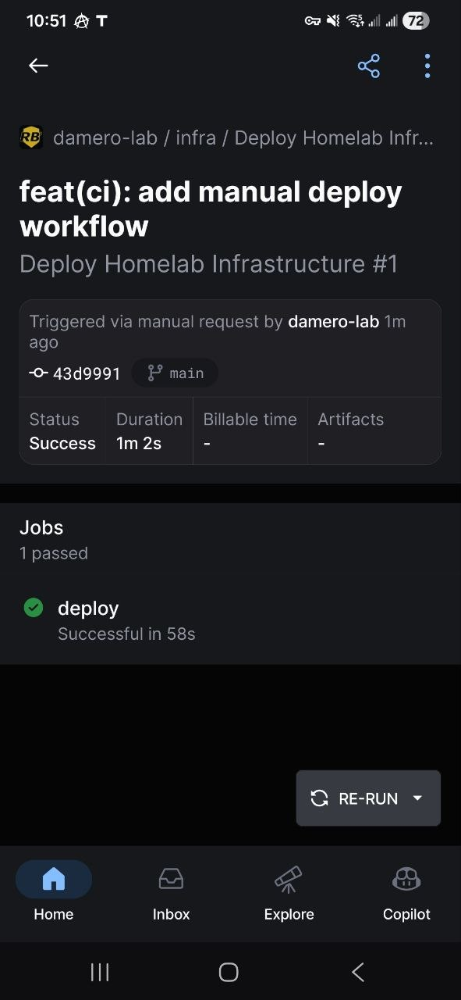

# Homelab Infrastructure as Code (IaC)

Автоматизированное развертывание тестового стенда с мониторингом Zabbix на базе Proxmox VE. Проект полностью автоматизирует создание виртуальных машин, их настройку и развертывание мониторинга с возможностью запуска из любой точки мира одной кнопкой.

## 🏗 Архитектура

- **Гипервизор:** Proxmox VE (`172.16.0.199`)
- **Управляющая машина:** `mgmt` (Debian, `172.16.0.248`) — здесь настроен Self-hosted GitHub Runner для запуска CI/CD.
- **Целевые VM (Astra Linux 1.8):**
  - `mon` (`172.16.0.200`) — Zabbix Server (Docker: Server, Web, PostgreSQL), Zabbix Agent.
  - `app-01` (`172.16.0.211`) — тестовая VM, Zabbix Agent.

### Схема развертывания и CI/CD

```mermaid
graph TD
    User([Инженер]) -->|Run workflow| GA[GitHub Actions<br>CI/CD Pipeline]
    GA -->|Self-hosted Runner| mgmt[Управляющая VM: mgmt<br>172.16.0.248]
    
    mgmt -->|Terraform| Proxmox[Proxmox VE<br>172.16.0.199]
    
    Proxmox -->|Клонирование шаблона| mon[VM: mon<br>172.16.0.200]
    Proxmox -->|Клонирование шаблона| app[VM: app-01<br>172.16.0.211]
    
    mgmt -->|Ansible| mon
    mgmt -->|Ansible| app
    
    subgraph Zabbix [Zabbix Stack]
        z_srv[Zabbix Server]
        z_web[Zabbix Web]
        z_db[PostgreSQL]
    end
    
    app -.->|Метрики| z_srv
    mon -.->|Метрики| z_srv

    🛠 Технологический стек
Terraform: Создание VM (модуль vm), настройка cloud-init, автоматическая генерация Ansible inventory.

Ansible: Настройка ОС (hardening, UFW), установка Docker, развертывание Zabbix, регистрация хостов через API.

Docker Compose: Запуск Zabbix Server, Web и PostgreSQL.

GitHub Actions: CI/CD пайплайн с ручным запуском (кнопка "Run workflow") и self-hosted runner'ом на базе mgmt.

📱 Управление с телефона (Zero-Touch Deploy)

В проекте настроен GitHub Actions. Вы можете развернуть или обновить всю инфраструктуру прямо с мобильного телефона:

Откройте репозиторий на GitHub.

Перейдите в раздел Actions.

Выберите Deploy Homelab Infrastructure.

Нажмите Run workflow.

Скриншот успешного запуска из мобильного приложения:


🚀 Как развернуть с нуля (вручную)
Настройте доступ к Proxmox API.

Заполните terraform.tfvars (токены, SSH-ключ).

Создайте VM (Terraform автоматически сгенерирует hosts.yml для Ansible):

bash
cd terraform/environments/homelab
terraform init
terraform apply
Запустите настройку Ansible (с машины mgmt):

bash
cd ansible
ansible-playbook playbooks/site.yml

✅ Как проверить
Зайдите в Zabbix Web UI: http://172.16.0.200:8080 (Admin / пароль из Ansible Vault).

Перейдите в Data collection -> Hosts. Вы должны увидеть Zabbix server и app-01.

Проверьте Monitoring -> Latest data — с агентов должны поступать данные (CPU, RAM и т.д.).