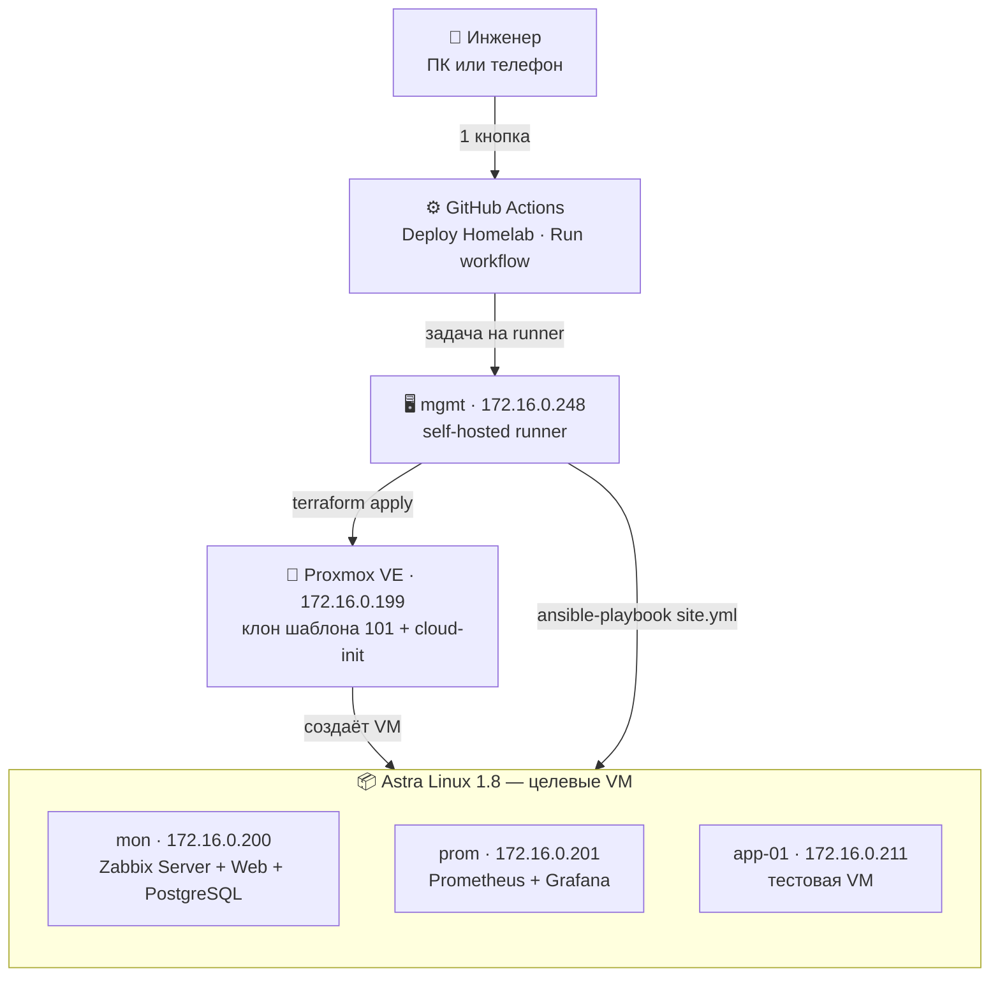
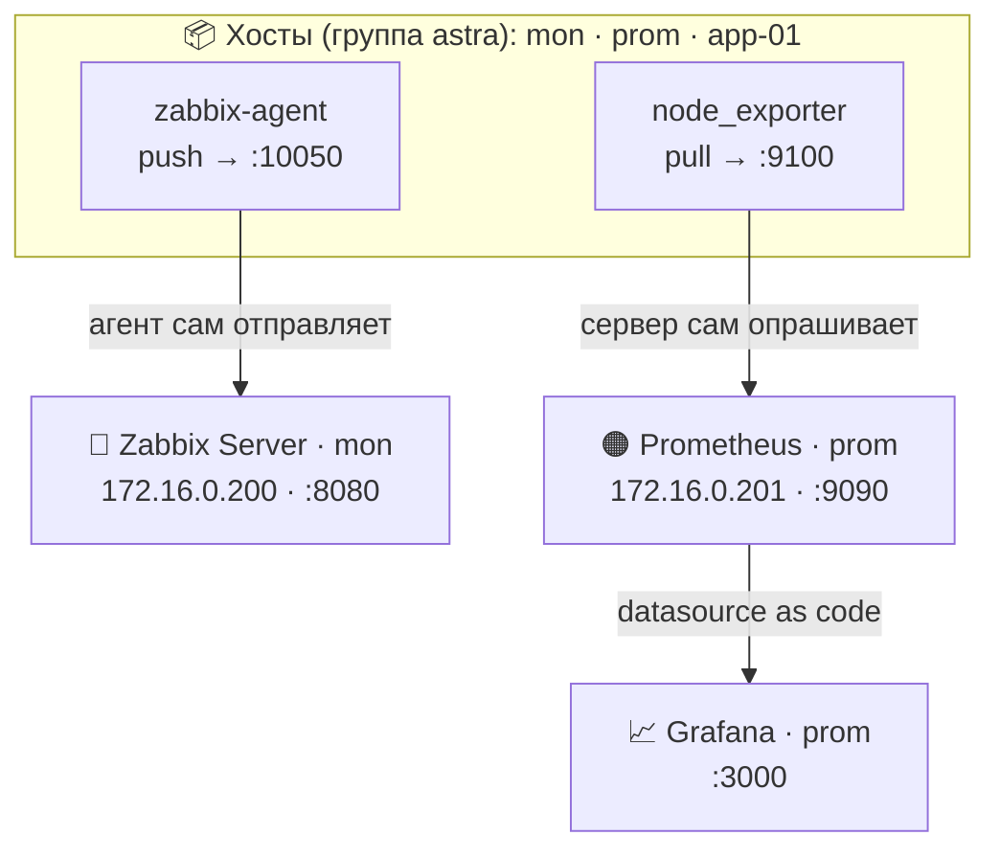
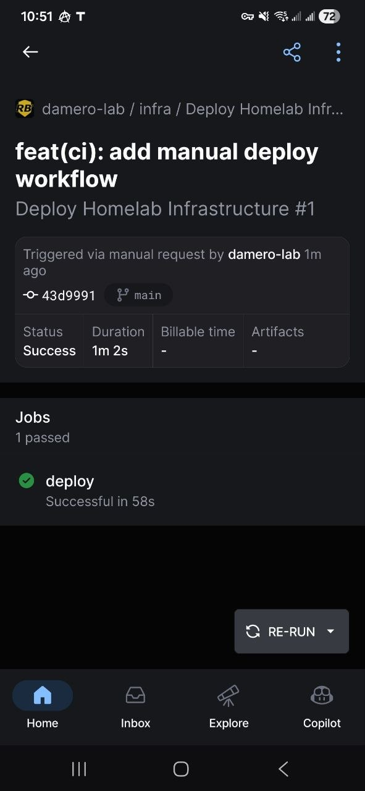

# 🏠 Homelab Infrastructure as Code

Автоматизированное развёртывание тестового стенда на базе **Proxmox VE**: виртуальные машины,
их конфигурация и стек мониторинга (**Zabbix** + **Prometheus/Grafana**) описаны как код и
поднимаются **одной кнопкой** из GitHub — в том числе с телефона. Принцип *Zero-Touch Deploy*.


> **Инфраструктура — это код, а не ручные действия в веб-интерфейсе.** Любое изменение проходит
> через Git: ветка → Pull Request → merge → деплой.

---

## 🏗 Архитектура

<picture>
  <source media="(prefers-color-scheme: dark)" srcset="docs/images/architecture-dark.svg">
  
</picture>

<details>
<summary>Исходник схемы (Mermaid)</summary>



</details>

### Компоненты

- **Proxmox VE** · `172.16.0.199` — гипервизор, где создаются VM (шаблон `astra-template`, ID `101`).
- **mgmt** (Debian) · `172.16.0.248` — управляющая машина: state Terraform, self-hosted GitHub Runner, запуск Ansible. SSH-bastion.
- **mon** (Astra Linux 1.8) · `172.16.0.200` — Zabbix Server + Web + PostgreSQL (Docker) + Zabbix Agent.
- **prom** (Astra Linux 1.8) · `172.16.0.201` — Prometheus + node_exporter + Grafana (Docker Compose).
- **app-01** (Astra Linux 1.8) · `172.16.0.211` — тестовая VM: Zabbix Agent + node_exporter.

---

## 🧠 Как это работает

- **Провижининг VM** — **Terraform** (`bpg/proxmox`): клонирует шаблон `101`, настраивает сеть через cloud-init, генерирует инвентарь Ansible.
- **Конфигурация** — **Ansible**: hardening + UFW, Docker, Zabbix, node_exporter, Prometheus, Grafana.
- **Оркестрация** — **GitHub Actions**: ручной запуск из GitHub UI, выполняется на self-hosted runner (`mgmt`).

**Единый источник правды — `terraform/environments/homelab/vms.auto.tfvars`.** Добавить хост =
добавить запись в реестр; инвентарь Ansible (`hosts.yml`) пересобирается сам и в Git не хранится
(это артефакт).

Поток деплоя: `terraform apply` → создаются/обновляются VM → `ansible-playbook playbooks/site.yml`
→ накатывается конфигурация и мониторинг.

---

## 📊 Две модели мониторинга

Стенд намеренно демонстрирует **обе классические модели сбора метрик** — один и тот же хост
отдаёт данные сразу двум системам.

<picture>
  <source media="(prefers-color-scheme: dark)" srcset="docs/images/monitoring-dark.svg">
  
</picture>

<details>
<summary>Исходник схемы (Mermaid)</summary>



</details>

**🔵 Zabbix — push-модель**

- Агент `zabbix-agent` (`:10050`) сам отправляет метрики на сервер.
- Сервер — `mon` (`http://172.16.0.200:8080`); визуализация — Zabbix Web UI.

**🟠 Prometheus + Grafana — pull-модель**

- Сервер сам опрашивает `node_exporter` (`:9100`) на хостах.
- Сервер — `prom` (`http://172.16.0.201:9090`); визуализация — Grafana (`:3000`), datasource и дашборд подключаются как код (provisioning).

**Grafana** стоит поверх Prometheus: datasource и дашборд `Homelab Overview` подключаются
**как код** (provisioning) — вручную в UI ничего не настраивается (иначе *config drift*).

---

## 📱 Zero-Touch Deploy с телефона

Развернуть или обновить всю инфраструктуру можно прямо с телефона:

1. Откройте репозиторий на GitHub.
2. Перейдите в раздел **Actions**.
3. Выберите workflow **Deploy Homelab Infrastructure**.
4. Нажмите **Run workflow**.

На self-hosted runner (`mgmt`) выполнится: `git reset --hard origin/main` → `terraform apply` →
`ansible-playbook playbooks/site.yml`.



---

## 🚀 Ручное развёртывание (с `mgmt`)

> Ansible запускается **из каталога `ansible/`** — там `ansible.cfg` задаёт инвентарь, ключ и
> файл Vault. Флаг `-i` не нужен.

```bash
# 1) Инфраструктура (VM) — Terraform
cd ~/infra/terraform/environments/homelab
terraform init
terraform apply

# 2) Конфигурация и мониторинг — Ansible
cd ~/infra/ansible
ansible-playbook playbooks/site.yml
```

Что подготовить заранее:

- **Proxmox API-токен** и **публичный SSH-ключ** — в `terraform.tfvars` (создать из
  `terraform.tfvars.example`; файл в `.gitignore`, в Git не попадает).
- **Пароли мониторинга** (Zabbix DB/Admin, Grafana Admin) — в **Ansible Vault**
  (`ansible/inventories/homelab/group_vars/all/vault.yml`), не в коде.

---

## ✅ Как проверить

- **Zabbix Web** — `http://172.16.0.200:8080`: *Data collection → Hosts* (список хостов), *Monitoring → Latest data* (метрики идут).
- **Prometheus** — `http://172.16.0.201:9090`: *Status → Targets* — таргеты `node_exporter` в статусе **UP**.
- **Grafana** — `http://172.16.0.201:3000`: дашборд **Homelab Overview**; *Connections → Data sources* — Prometheus **OK**.

Пароли — из Ansible Vault (`admin` для Zabbix Web и Grafana). Быстрая проверка Grafana из CLI:

```bash
curl -s http://172.16.0.201:3000/api/health   # → {"database":"ok", ...}
```

---

## 📁 Структура репозитория

```text
infra/
├── .github/workflows/
│   ├── deploy.yml            # Zero-Touch деплой (manual → self-hosted runner)
│   └── hello.yml             # smoke-тест окружения runner
├── ansible/
│   ├── ansible.cfg           # inventory, SSH-ключ, Vault (запуск из этой папки)
│   ├── inventories/homelab/  # group_vars (main.yml + vault.yml); hosts.yml — генерируется
│   ├── playbooks/site.yml    # 5 play: common → zabbix → zabbix-api → prometheus → grafana
│   └── roles/                # common, docker, zabbix-server, zabbix-agent,
│                             # zabbix-api, node_exporter, prometheus, grafana
├── docs/
│   ├── bootstrap-astra-template.md  # сборка шаблона Astra Linux для Proxmox
│   └── images/               # скриншоты + SVG-схемы (light/dark)
└── terraform/
    ├── environments/homelab/ # окружение: vms.auto.tfvars, main.tf, inventory.tpl
    └── modules/vm/           # переиспользуемый модуль VM (клон шаблона + cloud-init)
```

---

## 📚 Документация

- [Bootstrap шаблона Astra Linux для Proxmox](docs/bootstrap-astra-template.md)
- README ролей Ansible: [`common`](ansible/roles/common/README.md) ·
  [`docker`](ansible/roles/docker/README.md) ·
  [`zabbix-server`](ansible/roles/zabbix-server/README.md) ·
  [`zabbix-agent`](ansible/roles/zabbix-agent/README.md) ·
  [`zabbix-api`](ansible/roles/zabbix-api/README.md) ·
  [`node_exporter`](ansible/roles/node_exporter/README.md) ·
  [`prometheus`](ansible/roles/prometheus/README.md) ·
  [`grafana`](ansible/roles/grafana/README.md)
- [Terraform-модуль `vm`](terraform/modules/vm/README.md)

---

## 🗺 Roadmap / известные ограничения

- Применить `disk_size` / `disk_storage` в модуле `vm` (сейчас диск наследуется от шаблона).
- Перейти с `local` backend на **remote** с state locking (параллельные `apply` сейчас опасны).
- Добавить **PR-валидацию в CI**: `terraform plan`, `ansible-lint`, `--syntax-check` на `pull_request`.
- Автоматизировать **ротацию пароля Grafana** (смена секрета в Vault не меняет пароль в БД).
- Перегенерировать SVG-схемы (`docs/images/*.svg`, light/dark) при изменении Mermaid-исходника.

---

> 🔐 Секретов в репозитории нет: токены и пароли живут в `terraform.tfvars` и Ansible Vault,
> которые в `.gitignore`. Стенд — учебный (homelab), не для продакшена.

